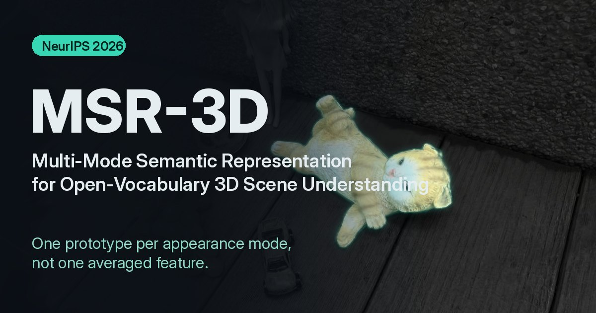
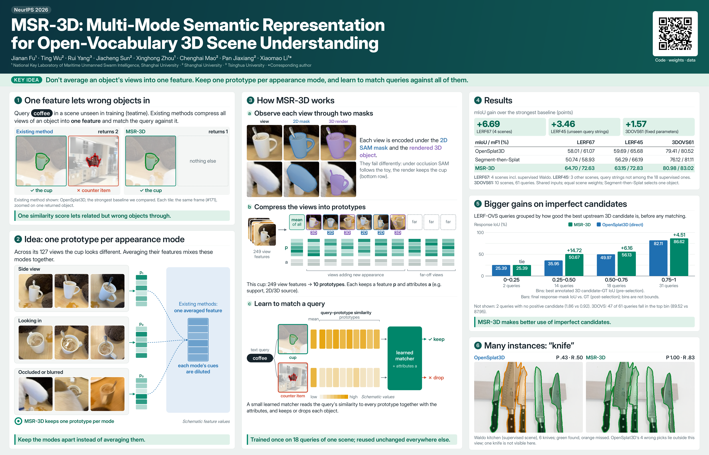

# MSR-3D: Multi-Mode Semantic Representation for Open-Vocabulary 3D Scene Understanding

**NeurIPS 2026**

**Jianan Fu, Ting Wu, Rui Yang, Jiacheng Sun, Xinghong Zhou, Chenghai Mao, Pan Jiaxiang, Xiaomao Li**

<p align="center">
  
</p>

<p align="center">
  <a href="https://SparklingPumpkin.github.io/MSR-3D/">Project page &amp; interactive 3D demo</a> ·
  <a href="https://SparklingPumpkin.github.io/MSR-3D/#video">Overview video</a> ·
  <a href="https://huggingface.co/datasets/KaiLai/MSR-3D-Data/tree/v1.1.0">Data v1.1.0</a> ·
  <a href="docs/assets/poster/MSR-3D-poster.pdf">Poster PDF</a>
</p>

MSR-3D matches open-vocabulary text queries to physical instances in reconstructed 3D scenes. Instead of averaging an object's different views into one feature, it keeps a prototype for each appearance mode and learns to match a query across those prototypes.

<p align="center">
  <a href="docs/assets/poster/MSR-3D-poster.pdf">
    
  </a>
</p>

The poster is available as a [1400 × 900 mm print-ready PDF](docs/assets/poster/MSR-3D-poster.pdf) and a [150-DPI PNG preview](docs/assets/poster/MSR-3D-poster.png). Watch the [overview video](https://SparklingPumpkin.github.io/MSR-3D/#video) on the project page.

## Results

Scene-averaged mIoU on the released benchmarks. Gains are percentage points over OpenSplat3D, the strongest compared method for these mIoU results. Methods use the same 3D reconstruction and object candidates.

| Evaluation set | Scope | MSR-3D mIoU | OpenSplat3D mIoU | Gain |
|---|---:|---:|---:|---:|
| LERF-OVS | 67 queries | 64.70 | 58.01 | +6.69 |
| LERF-OVS unseen-string subset | 45 queries | 63.15 | 59.69 | +3.46 |
| 3DOVS | 61 queries, 10 scenes | 80.98 | 79.41 | +1.57 |

See the [full results and interactive examples](https://SparklingPumpkin.github.io/MSR-3D/#results) and the [model card](MODEL_CARD.md) for evaluation details and limitations.

## Release

This repository contains the inference code and fixed matching weights for **code v1.2.0**, paired with **data v1.1.0**. The matching weights are unchanged from v1.0.0. The v1.1.0 data revision uses geometric top-five, middle-crop anchors for 3DOVS and retains all-three-crop anchors for LERF.

## Install

Python 3.11, an NVIDIA GPU, and a CUDA toolkit compatible with PyTorch are required.

```bash
git clone https://github.com/SparklingPumpkin/MSR-3D.git
cd MSR-3D
python -m venv .venv
source .venv/bin/activate
pip install '.[frontend]'
# Select the CUDA toolkit matching torch.version.cuda (12.4 for the tested setup).
export CUDA_HOME=/usr/local/cuda
pip install --no-build-isolation ./third_party/diff-gaussian-rasterization
```

Matching weights are bundled with the package. See [THIRD_PARTY.md](THIRD_PARTY.md) for upstream components and notices.

## Data

Download preprocessed scenes and optional observation pools/representations from [KaiLai/MSR-3D-Data on Hugging Face](https://huggingface.co/datasets/KaiLai/MSR-3D-Data/tree/v1.1.0). The dataset README links the official LERF images/cameras and CLIP/MasQCLIP checkpoints, which must be obtained separately.

```bash
pip install huggingface_hub
hf download KaiLai/MSR-3D-Data --repo-type dataset --revision v1.1.0 --local-dir ../MSR-3D-Data
python ../MSR-3D-Data/tools/prepare.py \
  --output ../msr3d-data \
  --lerf-root /path/to/lerf_ovs \
  --clip-weight /path/to/ViT-L-14-336px.pt \
  --masqclip-weight /path/to/base_novel.pth
```

The data covers four LERF scenes (67 queries, including the 45-query exact-string-unseen subset) and ten 3DOVS scenes (61 scene/query pairs). See [DATA_FORMAT.md](DATA_FORMAT.md) and [INPUT_FORMAT.md](INPUT_FORMAT.md) for data and input layouts.

## Run

```bash
python -m msr3d.pipeline \
  --data-root ../msr3d-data --dataset lerf67 --scene figurines \
  --output outputs/figurines
```

Use `--dataset 3dovs61 --scene sofa` for a 3DOVS scene. Each run writes its observation pool, representations, query features, predictions, and detailed evaluation results to a new output directory.

To reuse the supplied observation pool, add `--pool ../msr3d-data/precomputed/lerf67/figurines/pool`. Prototype construction uses 16 CPU threads and matching uses one thread; retain these defaults for numerical comparisons. See [PIPELINE.md](PIPELINE.md) for pipeline details.

For cached-feature matching and a quick CPU benchmark:

```bash
python -m msr3d.benchmark \
  --data-root ../msr3d-data/evaluation/cached-matcher-reference \
  --output outputs/benchmark --check-reference
```

Use `--split lerf45`, `--split lerf67`, or `--split 3dovs61` for one cohort. Results include per-query/per-frame records and both scene and query averages. Scene averages weight each scene equally; mF1 measures physical-instance set retrieval.

## Validation and limitations

The release record reports validation from newly extracted code and data archives, including fresh three-stage runs on all ten 3DOVS scenes and cached evaluation on 128 scene/query pairs. This validation used the same machine and an existing offline CUDA environment; a fresh online installation on different hardware has not been verified. See [MODEL_CARD.md](MODEL_CARD.md) for the complete validation scope, supervision details, and limitations.

## Rights and third-party components

This repository does not add a permissive license or change ownership of the code or learned parameters. Third-party assets retain their respective rights and license terms. See [MODEL_CARD.md](MODEL_CARD.md) and [THIRD_PARTY.md](THIRD_PARTY.md).

## Citation

```bibtex
@inproceedings{fu2026msr3d,
  title     = {{MSR-3D}: Multi-Mode Semantic Representation for
               Open-Vocabulary 3D Scene Understanding},
  author    = {Jianan Fu and Ting Wu and Rui Yang and Jiacheng Sun and
               Xinghong Zhou and Chenghai Mao and Pan Jiaxiang and Xiaomao Li},
  booktitle = {Advances in Neural Information Processing Systems},
  year      = {2026}
}
```

## Check

```bash
python -m unittest discover -s tests -v
```
